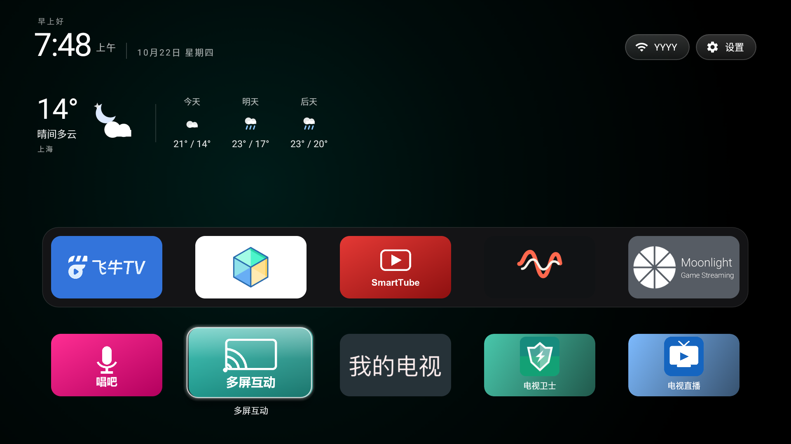

# 东芝 65U6900C 电视改造套件

一台 2019 年的入门级 4K 电视（TCL 代工，机芯 MS838AS13，Android 6.0 / API 23，4×Cortex-A53 1.5 GHz，2 GB RAM，无 GMS，系统早已停更）的实测改造记录与自研组件。

原厂系统卡顿、广告多、预装多、桌面不可换、遥控器语音键被讯飞助手独占。这套东西把能改的都改了，全部可回滚。

> 仅用于**你自己拥有**的设备。改动涉及系统分区、包管理与厂商私有服务，误操作可能导致无法开机，风险自负。



*实拍（1920×1080）：cleanyourtv 移植版桌面 —— 顶部天气卡（当前 / 明天 / 后天），下面一排应用磁贴，最底是程序坞。*

## 优化前后对比

| 维度 | 原厂 | 现在 |
|---|---|---|
| 桌面 | TCL 瀑布流 `com.tcl.cyberui`，系统里唯一的 HOME 提供者，Home 键强制回弹，换不了 | cleanyourtv 移植版：天气卡 + 磁贴 + 程序坞，可换、可编辑、可长按卸载 |
| 开机 | 先播 TCL 开机广告（`com.tcl.bootadservice`） | 直接进桌面 |
| 预装常驻 | 广告 / 统计 / 推送 / 应用商店 / OTA / 语音助手全套在跑 | 31 个 `pm hide`（4 个因语音输入法需要已恢复，实冻 27），`rollback.ps1` 一条命令还原 |
| 装第三方 APK | 被 `com.tcl.packageinstaller.service` 秒关，只能走 TCL 应用商店 | `adb install` / U 盘直装，重启后仍有效 |
| 遥控器语音键 | 拉起讯飞语音助手，弹广告，打不出字 | 语音输入法，说完直接上屏到任意输入框 |
| 看电视直播 | 无（原厂只剩已下架的 VOD 入口） | 自建直播 App，37 个频道：央视 1–17 + 10 个央视付费频道 + 10 个卫视 |
| 第三方 App | 0 | 10 个（其中 3 个是本仓库自研） |
| 桌面图标 | 海报位，比例各不相同 | 统一横幅磁贴 |

### 没有变的（也是软件优化的天花板）

真正的瓶颈是 2019 年的入门级 SoC + 2 GB RAM + Android 6，这部分改不动：

- **CPU**：整机占用约 50%（12 秒 `/proc/<pid>/stat` 增量采样，4 核合计）。其中 `MiSysSrv`（MStar 画质 / Scaler，实际 cmdline 是 `/applications/bin/MiSysSrv`，进程自行改名）单进程占 75.3% 单核 ≈ 18.8% 整机；`sitatvservice` 33.8% 单核 ≈ 8.4%。这两个是画质与信号处理链，停不得。
- **超频不可行**（三层锁）：`adb root` 失败、写 `scaling_governor` 被 `Permission denied`、`cpuinfo_max_freq=1500000` 写死在内核 OPP 表里，MStar 不公开源码。
- **内存**：`dumpsys meminfo` 口径下 Free RAM 随运行时长在 605～823 MB 之间波动（同一台机器不同时刻实测），冻结包带来的是 +73 MB free / −47 MB used 量级的改善——有意义，但不是质变。`MemFree` 本身没有参考价值，会被页面缓存吃满（Cached 常年 900 MB+）。

结论：软件侧已经做到边际，想明显提速只有外接电视盒子。

## 目录

| 目录 | 内容 |
|---|---|
| [`livetv/`](livetv/) | 自建直播 App（`com.local.livetv`），37 个央视/卫视频道，遥控器换台 |
| [`voicekey/`](voicekey/) | 把遥控器语音键做成**语音输入法**（`com.iflytek.sample.view`），说句话直接上屏 |
| [`launcher/`](launcher/) | [cleanyourtv](https://github.com/Gathin23/cleanyourtv) v2.5 的 fork：API 23 移植 + 天气卡 / 程序坞编辑 / 长按卸载 / 图标统一 |
| [`tools/`](tools/) | 设备侧工具：TCL root 通道、APK 结构侦察、部署脚本 |
| [`docs/`](docs/) | [东芝65U6900C-优化记录.md](docs/东芝65U6900C-优化记录.md) —— 二十四节完整实测记录（内存/CPU 口径、包清单、踩坑、回滚命令） |

## 设备事实（后续所有结论的前提）

```
persist.sys.tvname        = TSB 65U6900C-80BF
ro.software.version_id    = V8-S38AS13-LF1V041   （官方最高版，已停更）
平台                      = aosp_tsbU9800C / tsbU9800C，机芯 MS838AS13
系统                      = Android 6.0（API 23）/ MRA58K，userdebug + dev-keys
CPU                       = 4×Cortex-A53 1.5 GHz（ondemand）
内存                      = 2 GB（MemTotal 1,871,796 kB）
显示                      = 面板 3840×2160，Android UI 1920×1080（硬件上采样）
无 GMS / 无 Play 商店 / 无 dm-verity / /system ext4 ro
```

## 三条最有用的结论

1. **装不上第三方 APK 不是签名问题**，是 TCL 的 `com.tcl.packageinstaller.service` 在监视并秒关系统安装器。`pm hide com.tcl.packageinstaller.service` 之后任何 APK 都能装，且跨重启保持。
2. **遥控器语音键（厂商键 4113）会投递给当前输入法**，所以可以把语音助手变成输入法；识别本身不要自己录音（麦克风被助手独占，`AudioRecord.read()` 恒返回 0），而是复用 xiri 的 `WriteRecognizerService`（AIDL，无权限保护）并劫持它的 UI 回调通道取文字。
3. **本机 MediaPlayer 不支持 IPv6 源**（`DataSource_M3U8: httpResponseCode=0` 死循环），直播源必须用 IPv4。

## 构建前提

所有 App 都不依赖 Android Studio，用 `aapt + javac + d8 + zipalign + apksigner` 直接打包，见各子目录的 `build.py`。需要：

- JDK 17
- Android SDK build-tools 34（`aapt` / `zipalign` / `apksigner`）
- `platforms/android-34/android.jar`
- 一个自己的签名 keystore

`launcher/` 例外，它是 Gradle 工程，需要 JDK 17 + Android SDK Platform 34。

## 许可

本仓库自有代码为 MIT。`launcher/` 基于上游 [cleanyourtv](https://github.com/Gathin23/cleanyourtv) 亦为 MIT（Copyright © 2026 Gathin），改动文件保留上游版权声明。
